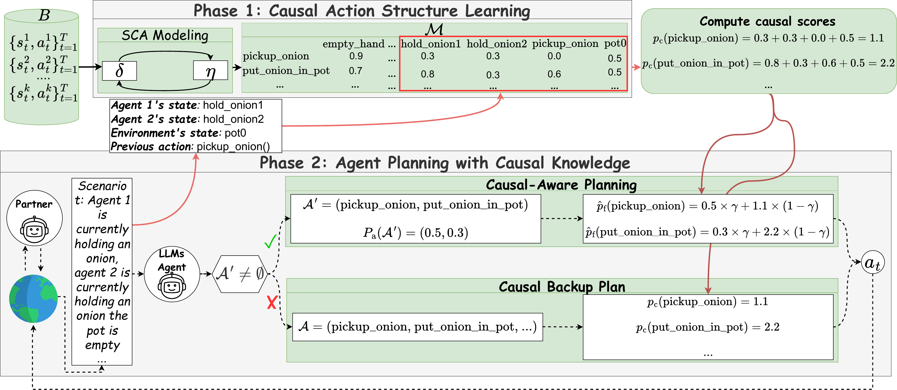

# CausalPlan: Empowering Efficient LLM Multi-Agent Coordination Through Causality-Inspired Planning

[](https://arxiv.org/abs/2508.13721)

Official implementation of **CausalPlan**, a two-phase framework that adds learned structural knowledge to the decoding process of LLM agents for multi-agent coordination. It needs no fine-tuning.

LLM agents, especially small open-source ones, often produce *causally invalid* plans in coordination tasks: for example, putting an onion in a pot without holding one. They rely on surface-level statistical correlations instead of grounded causal reasoning. CausalPlan first learns a **Structural Causal Action (SCA) model** from agent trajectories. The model captures how the current state and the previous action influence the next action. CausalPlan then uses this model as a structural prior when the LLM plans:

- **Causal-Aware Planning** re-weights the LLM's candidate actions using their causal scores.
- **Causal Backup Plan** gives a causally grounded fallback when the LLM proposes no valid action.

<p align="center">
  
</p>

We evaluate CausalPlan on the [Overcooked-AI](https://github.com/HumanCompatibleAI/overcooked_ai) benchmark:

- **Layouts:** five multi-agent coordination layouts.
- **Backbones:** Gemma-7B, Llama-8B, Qwen-14B and Llama-70B.
- **Partners:** AI partners (SP, PBT, FCP, MEP, COLE) and human-proxy partners (behavior cloning).

CausalPlan consistently reduces causally invalid actions and improves coordination over the LLM backbones and strong RL baselines.

---

## Contents

- [How it works](#how-it-works)
- [Repository structure](#repository-structure)
- [Installation](#installation)
- [Quick start](#quick-start)
- [Reproducing the experiments](#reproducing-the-experiments)
- [Learning the causal action matrix](#learning-the-causal-action-matrix)
- [Hyperparameters](#hyperparameters)
- [Acknowledgements](#acknowledgements)
- [Citation](#citation)

## How it works

**Phase 1: Causal Action Structure Learning.**

- **Data collection.** A behavior policy $\pi_\beta$ (a pretrained MEP agent by default) collects a buffer $B$ of successfully executed actions.
- **Variables.** Each sample is factorised into binary variables:
  - Ego state: held object and pot states.
  - Partner state: the partner's held object.
  - Previous action $a_{t-1}$.
  - Next action $a_t$.
- **Training.** The SCA model learns structural parameters $\eta$ (edge logits) and functional parameters $\delta$ (one MLP per action) jointly. It masks inputs with the edge probabilities $\sigma(\eta)$ and adds a sparsity prior.
- **Output.** This yields the **causal action matrix** $\mathcal{M}$ (`data/*.pt`), whose entry $(i, j)$ is the probability that feature $j$ is a parent of action $i$.

**Phase 2: Agent Planning with Causal Knowledge.** CausalPlan builds on the [ProAgent](https://github.com/PKU-Alignment/ProAgent) agent. At every decision step:

1. An *analysis* LLM (Command R by default) analyses the scene. The planner LLM then samples 20 candidate plans. Each candidate's sequence probability gives $p_a$.
2. A verifier keeps the candidates that satisfy the physical constraints of the current state. This forms the candidate set $\mathcal{A}'$.
3. **Causal-Aware Planning** ($\mathcal{A}' \neq \emptyset$):
   - The causal score $p_c(a) = \sum_{j \in \mathrm{Active}(s_t, a_{t-1})} \mathcal{M}[a, j]$ is fused with the LLM probability: $\hat p_f = \gamma\, p_a + (1-\gamma)\, p_c$.
   - The fused scores are normalised with a softmax.
   - Semantically equivalent proposals are merged by summing their probabilities.
   - The final action is sampled from the result.
4. **Causal Backup Plan** ($\mathcal{A}' = \emptyset$): the agent takes $\arg\max_{a \in \mathcal{A}} p_c(a)$ over the full action space. If that action also fails, the LLM re-plans.

The low-level controller (best-first search) and the explainer (belief correction) modules are inherited from ProAgent.

## Repository structure

```
.
├── assets/                    # figures
├── data/                      # pretrained causal action matrices M (one per layout / player)
├── lib/
│   ├── overcooked_ai/         # Overcooked-AI environment (version used by ProAgent / COLE)
│   └── stable-baselines/      # only needed to load the behavior-cloning (human proxy) partners
├── models/                    # (download) pretrained partner agents, see below
└── src/
    ├── main_causal.py         # entry point: data collection, SCA training and evaluation
    ├── causal_graph/          # SCA model (cramped room: 1 pot; other layouts: 2 pots)
    ├── proagent/
    │   ├── proagent.py        # LLM agent: analysis, planning, verification, controller
    │   ├── modules.py         # LLM backends + causal-aware planning and causal backup plan
    │   └── utils.py           # action normalisation and merging
    ├── prompts/               # ProAgent prompt library (planner / explainer)
    ├── utils.py               # partner agents (RL, BC, Greedy), seeding, result saving
    └── utils_causal.py        # state/action factorisation, buffers, causal matrix I/O
```

## Installation

**1. Main environment** (CausalPlan agent, SCA training, RL partners):

```bash
conda env create -f environment.yaml
conda activate causalplan
pip install -e lib/overcooked_ai
```

You can also use an existing Python ≥ 3.10 environment with a CUDA build of PyTorch:

```bash
pip install -r requirements.txt
pip install -e lib/overcooked_ai
```

**2. Partner agents.** The pretrained SP, PBT, FCP, MEP, COLE and behavior-cloning partners come from the [COLE-Platform](https://github.com/liyang619/COLE-Platform), as in [ProAgent](https://github.com/PKU-Alignment/ProAgent).

1. Download them from [Google Drive](https://drive.google.com/drive/folders/1s88a_muyG6pVlfcKDKop6R1Fhxr8dcGH).
2. Place them in `./models` so the structure is `models/<layout>/<algorithm>` (plus `models/bc_runs`).
3. To use another location, set `CAUSALPLAN_MODELS_DIR`.

The model folders use the original layout names:

| Paper name | Code (`--layout`) | Model folder |
|---|---|---|
| Cramped Room (CR) | `cramped_room` | `simple` |
| Asymmetric Advantages (AA) | `asymmetric_advantages` | `unident_s` |
| Coordination Ring (COR) | `coordination_ring` | `random1` |
| Forced Coordination (FC) | `forced_coordination` | `random0` |
| Counter Circuit (CC) | `counter_circuit` | `random3` |

**3. Behavior-cloning partners (optional).** The BC (human-proxy) models were trained with TensorFlow 1 and `stable-baselines`, so they need a separate environment:

```bash
conda env create -f environment_bc.yaml
conda activate causalplan_bc
pip install -e lib/overcooked_ai -e lib/stable-baselines
```

**4. LLM access.**

- **Planner:** a local Hugging Face model. Gemma and Llama are gated, so accept their licences and run `huggingface-cli login`.
- **Analysis and explainer:** these use Cohere's Command R through the official `cohere` client by default. Set your key with `export COHERE_API_KEY=...`, or put `COHERE_API_KEY=...` in `src/proagent/secrets.env`, which git ignores.
- **Without a Cohere key:** you can pass any supported Hugging Face model to `--gpt_analysis_model` and `--gpt_explainer_model`.

| Backbone (paper) | `--gpt_planner_model` | GPU memory |
|---|---|---|
| Gemma-7B | `google/gemma-1.1-7b-it` | ~16 GB |
| Llama-8B | `meta-llama/Meta-Llama-3-8B-Instruct` | ~16 GB |
| Qwen-14B | `Qwen/Qwen2.5-14B-Instruct-1M` | ~30 GB |
| Llama-70B | `meta-llama/Llama-3.3-70B-Instruct` | > 140 GB (multi-GPU) |

Models are loaded in bfloat16 with `device_map="auto"`, so they are split across all visible GPUs automatically.

## Quick start

All commands are run from `src/`:

```bash
cd src

# CausalPlan (Llama-8B backbone) as Player 1, collaborating with a COLE partner on Cramped Room
python main_causal.py --layout cramped_room --p0 COLE --p1 ProAgent \
    --gpt_planner_model meta-llama/Meta-Llama-3-8B-Instruct --gamma 0.5 --seed 0
```

Results are saved as JSON under `src/experiments/`. Each file includes the episode return and the number of rejected (causally invalid) plans, `fail_count`.

The causal action matrix for the CausalPlan player is selected automatically from `data/` based on the layout and the player index. Use `--causal_graph_path` to load a different one.

## Reproducing the experiments

Every evaluation runs 400 timesteps per episode. Each reported number is averaged over 3 seeds (`--seed 0/1/2`).

**Backbone vs. CausalPlan with AI partners.** The LLM agent plays as Player 1. To evaluate the Player 0 role, swap `--p0` and `--p1`.

```bash
# CausalPlan
python main_causal.py -l forced_coordination --p0 MEP --p1 ProAgent \
    --gpt_planner_model Qwen/Qwen2.5-14B-Instruct-1M --gamma 0.7 --seed 0

# Backbone only (ProAgent with the same LLM, no causal knowledge)
python main_causal.py -l forced_coordination --p0 MEP --p1 ProAgent \
    --gpt_planner_model Qwen/Qwen2.5-14B-Instruct-1M -cg False -fh False --seed 0
```

| Option | Values |
|---|---|
| `--layout` | `cramped_room`, `asymmetric_advantages`, `coordination_ring`, `forced_coordination`, `counter_circuit` |
| `--p0` / `--p1` partners | `SP`, `PBT`, `FCP`, `MEP`, `COLE`; also `Greedy`, `Random`, `Stay` |
| `--gamma` | see [Hyperparameters](#hyperparameters) |

**RL baselines:** use any pair of RL agents, for example `python main_causal.py -l cramped_room --p0 FCP --p1 COLE --seed 0`.

**Human-proxy partners.** These need the BC environment. `--episode 5` runs one episode with each of the five BC policies.

```bash
python main_causal.py -l cramped_room --p0 BC --p1 ProAgent \
    --gpt_planner_model meta-llama/Llama-3.3-70B-Instruct --episode 5 --seed 0
```

**Ablations:**

| Variant | Flags |
|---|---|
| Without Causal-Aware Planning | `-cg False` |
| Without Causal Backup Plan | `-fh False` |
| Backbone only | `-cg False -fh False` |
| Causal matrix learned from Llama-8B data instead of MEP (Cramped Room) | `--ablation True` |

**Cross-layout transfer.** This uses the matrix learned on Asymmetric Advantages in another two-pot layout:

```bash
python main_causal.py -l counter_circuit --p0 COLE --p1 ProAgent -tgs aa \
    --gpt_planner_model meta-llama/Meta-Llama-3-8B-Instruct --seed 0
```

## Learning the causal action matrix

You can skip this step by using the matrices in `data/`, named `edge_params_..._{layout}_act_only_p{player}.pt`. Some layout and player pairs have no released matrix, for example Counter Circuit with CausalPlan as Player 1. Train those with the two steps below.

**Step 1: collect the buffer $B$** with the behavior policy (MEP for both players). This records $N = 50 \times 400 = 20{,}000$ timesteps of completed actions for the chosen player:

```bash
python main_causal.py -l counter_circuit --p0 MEP --p1 MEP \
    --save_buffer True --record_action_only True --collect_data p1 \
    --horizon 400 --episode 50 --seed 0 \
    -bp buffer_cc_mep_p1.pt
```

**Step 2: train the SCA model** and save the causal action matrix to `data/`. Training losses are logged to Weights & Biases if `wandb` is installed; set `WANDB_MODE=disabled` to turn this off.

```bash
python main_causal.py -l counter_circuit --train_SCM True --train_SCM_step 50000 \
    -bp buffer_cc_mep_p1.pt \
    -cgp edge_params_with_action_after_200k_train_50k_test_w_op_final_cc_act_only_p1.pt
```

If you save the matrix under the default name pattern, as in this example, evaluation runs pick it up automatically. Otherwise pass it with `--causal_graph_path`.

## Hyperparameters

**SCA model:**

| Parameter | Value |
|---|---|
| Buffer size $N$ / episode horizon $T$ | 20,000 / 400 |
| $f_i$ architecture | MLP, hidden sizes 64-256-256-64, ReLU, sigmoid output |
| Optimizer / learning rate | Adam / 3e-4 |
| Sparsity coefficient $\lambda$ | 1e-7 (`--sparsity_lambda`) |
| Training iterations | 50,000 (`--train_SCM_step`) |

**LLM agent:**

| Parameter | Value |
|---|---|
| Candidate plans per step | 20 |
| Temperature / top-k / top-p | 1.0 / 50 / 0.9 |
| Max new tokens | 256 |
| Prompt level / retrieval / K | `l2-ap` / `recent_k` / 1 |

**$\gamma$ in Eq. 6** (`--gamma`):

| Layout | Gemma-7B | Qwen-14B | Llama-8B | Llama-70B |
|---|---|---|---|---|
| CR, AA, COR, CC | 0.5 | 0.5 | 0.5 | 0.5 |
| FC | 0.6 | 0.7 | 0.4 | 0.5 |

## Acknowledgements

This code builds on the following open-source projects. We thank their authors.

- [ProAgent](https://github.com/PKU-Alignment/ProAgent): LLM agent framework, prompts and controller.
- [Overcooked-AI](https://github.com/HumanCompatibleAI/overcooked_ai): the environment.
- [COLE-Platform](https://github.com/liyang619/COLE-Platform): pretrained RL and behavior-cloning partners.
- [Crafter](https://github.com/danijar/crafter): the long-horizon benchmark used in our additional experiments.

## Citation

If you find this work useful, please cite:

```bibtex
@article{nguyen2025causalplan,
  title   = {CausalPlan: Empowering Efficient LLM Multi-Agent Coordination Through Causality-Inspired Planning},
  author  = {Nguyen, Minh Hoang and Do, Van Dai and Nguyen, Dung and Nguyen, Thin and Le, Hung},
  journal = {arXiv preprint arXiv:2508.13721},
  year    = {2025}
}
```

Please also consider citing the works this code builds on:

```bibtex
@inproceedings{zhang2024proagent,
  title     = {ProAgent: Building Proactive Cooperative Agents with Large Language Models},
  author    = {Zhang, Ceyao and Yang, Kaijie and Hu, Siyi and Wang, Zihao and Li, Guanghe and Sun, Yihang and Zhang, Cheng and Zhang, Zhaowei and Liu, Anji and Zhu, Song-Chun and Chang, Xiaojun and Zhang, Junge and Yin, Feng and Liang, Yitao and Yang, Yaodong},
  booktitle = {Proceedings of the AAAI Conference on Artificial Intelligence},
  year      = {2024}
}

@inproceedings{carroll2019utility,
  title     = {On the Utility of Learning about Humans for Human-AI Coordination},
  author    = {Carroll, Micah and Shah, Rohin and Ho, Mark K. and Griffiths, Tom and Seshia, Sanjit and Abbeel, Pieter and Dragan, Anca},
  booktitle = {Advances in Neural Information Processing Systems},
  year      = {2019}
}

@inproceedings{li2023cooperative,
  title     = {Cooperative Open-ended Learning Framework for Zero-Shot Coordination},
  author    = {Li, Yang and Zhang, Shao and Sun, Jichen and Du, Yali and Wen, Ying and Wang, Xinbing and Pan, Wei},
  booktitle = {International Conference on Machine Learning},
  year      = {2023}
}
```

## License

This project is released under the [MIT License](LICENSE). The bundled `lib/overcooked_ai` and `lib/stable-baselines` keep their original MIT licenses.
